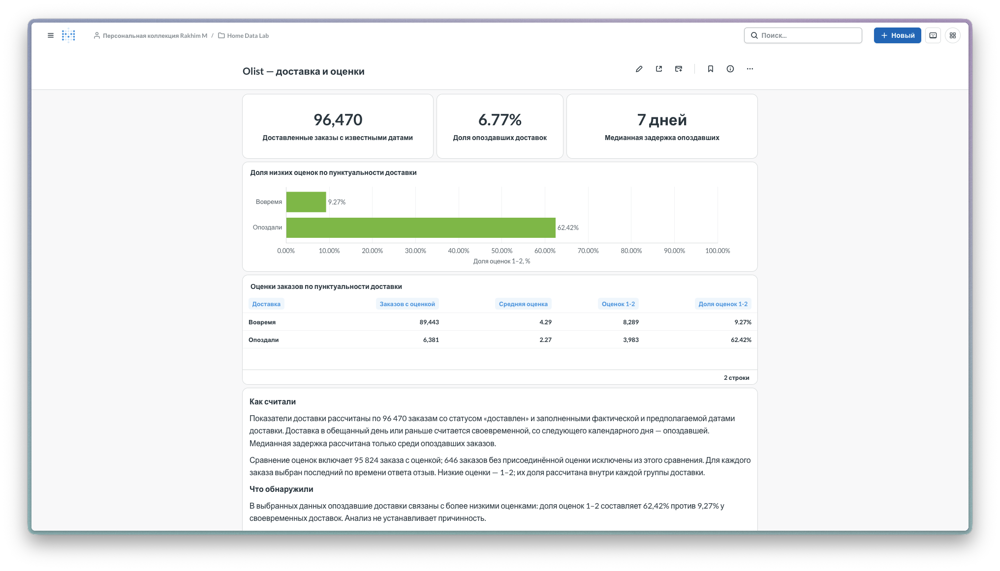

# Home Data Lab

Домашняя аналитическая лаборатория: от загрузки исходных CSV в PostgreSQL до SQL-анализа, статистических проверок в Python и дашборда Metabase. Среда работает на собственном сервере с Ubuntu; DBeaver, Jupyter и доступ к BI используются с MacBook через SSH.

Первое исследование посвящено **своевременности доставки и оценкам покупателей Olist**. Версия 0.1 — SQL и дашборд, версия 0.2 — распределение оценок, длина задержки и статистические проверки в pandas.

## Главный результат

Из 96 470 доставленных заказов с известными фактической и предполагаемой датами **6,77% опоздали**. Медианная задержка среди опоздавших — **7 календарных дней**.

| Доставка | Заказов с оценкой | Средняя оценка | Доля оценок 1–2 |
|---|---:|---:|---:|
| С опозданием | 6 381 | 2,27 | 62,42% |
| Вовремя или раньше | 89 443 | 4,29 | 9,27% |

Опоздавшие доставки связаны с более низкими оценками. Это основание подробнее изучить жалобы, сопровождающие задержки. Сравнение не устанавливает причинность и не позволяет предсказать эффект устранения опозданий.

**[Отчёт: вопрос, методика, выводы и ограничения](analysis/olist/REPORT.md)** · **[Проверки данных](analysis/olist/data_quality.md)** · **[SQL](sql/olist/README.md)**

### Версия 0.2: глубже

- **Важна длина задержки.** Ранняя доставка почти не повышает оценку: корреляция Спирмена у пришедших вовремя — −0,05. После предполагаемой даты оценка падает с каждым днём: у опоздавших −0,40. Доля оценок 1 — 18,7% при задержке 1–2 дня и около 70% при задержке от 6 дней.
- **Связь не случайна и заметна по силе.** χ²: p < 0,001, V Крамера 0,42. В 82% пар «вовремя — опоздал» у заказа, пришедшего вовремя, оценка выше.
- **Большинство опоздавших оценивают заказ до получения.** Так ответили 70,1% покупателей опоздавших заказов, и 70,9% этих оценок — единицы.
- **Связь сохраняется при учёте других признаков.** Логистическая регрессия: отношение шансов низкой оценки при опоздании — 17,4 при равных числе позиций, стоимости, доставке и весе (16,3 без них).

**[Отчёт v0.2](analysis/olist/REPORT_v0.2.md)** · **[Ноутбук с расчётами](analysis/olist/notebooks/01_delivery_reviews.ipynb)**

## Дашборд

Три показателя описывают частоту и величину задержек; график и таблица сравнивают оценки двух групп. [Описание и инструкция сборки](analysis/olist/dashboard.md). Живой Metabase доступен через SSH; репозиторий содержит снимок и материалы воспроизведения.

## Цель и устройство проекта

Цель — построить собственную среду для аналитической работы и пройти весь путь на реальном публичном наборе: загрузить данные, проверить их, сформулировать вопрос, получить обоснованный вывод и представить результат в BI.

| Инструмент | Назначение |
|---|---|
| Ubuntu, Docker Compose | Серверная среда и контейнеры |
| PostgreSQL 18 | Хранение девяти исходных таблиц и аналитические расчёты |
| DBeaver | Работа с SQL с MacBook |
| Python, Jupyter: pandas, SciPy, statsmodels | Анализ версии 0.2: распределения, доверительные интервалы, χ², Спирмен, Манн–Уитни, логистическая регрессия |
| Metabase Open Source | Карточки показателей, сравнение групп и дашборд |
| SSH | Доступ к серверу и локальным портам сервисов |

Лаборатория развёрнута на домашнем сервере: Ryzen 3 1200, 16 ГБ RAM, SSD 512 ГБ для системы и PostgreSQL, HDD 1 ТБ для исходных файлов. Это собственная среда анализа с раздельными ролями чтения и администрирования. [Архитектура и принятые решения](docs/architecture.md).

## Как выполнен анализ

1. Загружены девять CSV Olist; количество строк в таблицах сверено с файлами.
2. Проверены идентификаторы заказов, даты, временное покрытие и сочетания статусов с фактической доставкой.
3. Определена выборка доставленных заказов и календарное правило опоздания.
4. Несколько отзывов на заказ сведены к последнему по времени ответа; проверено, что соединение не размножает заказы.
5. Рассчитаны доля опозданий, медианная задержка, средняя оценка и доля низких оценок по группам.
6. Результаты собраны в отчёт и дашборд с явными определениями и ограничениями.
7. В версии 0.2 те же данные прочитаны в pandas, базовые числа версии 0.1 повторены, затем добавлены распределение оценок 1–5, длина задержки и статистические проверки. Выводы опираются на величину связи, а не только на p-value.

## Данные и воспроизведение

Источник — [Brazilian E-Commerce Public Dataset by Olist](https://www.kaggle.com/datasets/olistbr/brazilian-ecommerce): 99 441 заказ, даты оформления в файлах — с 4 сентября 2016 года по 17 октября 2018 года. Исходные данные не включены в репозиторий. [Состав и контрольные суммы](data/README.md).

Для расчётов нужны PostgreSQL, роли `lab_admin` и `analyst`, база `home_data_lab` и исходные CSV. [Порядок загрузки, проверки и запуска SQL](docs/reproduce.md).

В репозитории есть SQL, скрипт импорта и конфигурация Metabase. Полное автоматическое развёртывание с нуля и машинный экспорт дашборда пока не подготовлены.

## Структура

| Путь | Содержимое |
|---|---|
| `analysis/olist/` | Отчёты v0.1 и v0.2, проверки данных, дашборд |
| `analysis/olist/notebooks/` | Jupyter-ноутбук версии 0.2 |
| `sql/olist/` | Создание таблиц, проверки, расчёты и запросы BI |
| `data/` | Описание источника и контрольные суммы |
| `scripts/` | Первоначальный импорт CSV |
| `infra/metabase/` | Compose-конфигурация и инструкция запуска BI |
| `docs/` | Архитектура и воспроизведение |

## Развитие

Следующие возможные исследования — регион покупателя и число продавцов в модели оценок, темы текстовых отзывов и структура стоимости товаров по категориям. Они находятся за пределами текущего анализа.

Учебный проект выполнен с помощью ИИ-наставника: помощь использовалась при разборе SQL, pandas и статистических методов, проверке логики и редактуре материалов. В версии 0.2 применён подход к аналитическим проектам из книги David Asboth «The Well-Grounded Data Analyst» (Manning, 2025).
