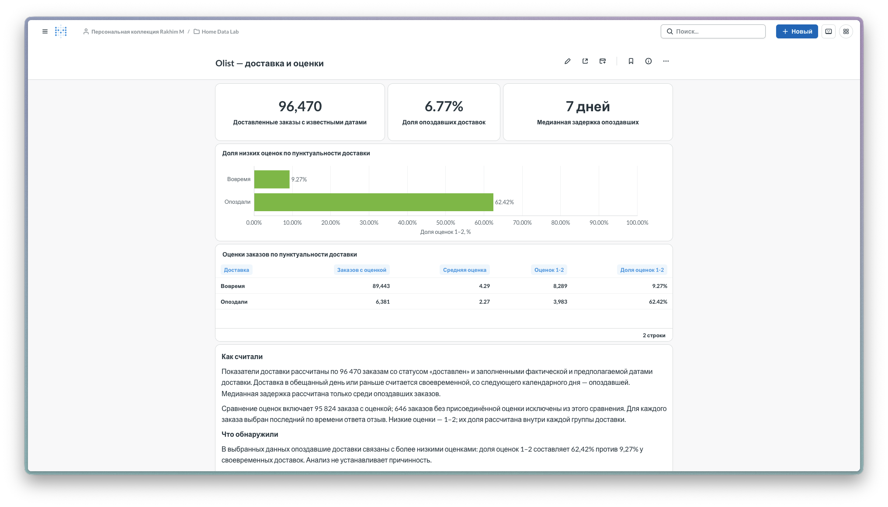

# Olist — доставка и оценки

Дашборд Metabase отвечает на три вопроса: как часто доставка опаздывает, насколько велики задержки и как различаются оценки покупателей у двух групп доставки.

Снимок показывает показатели, график, таблицу и большую часть пояснений. Полное описание выборки и вывода приведено ниже.

## Состав дашборда

| Элемент | SQL и визуализация | Значение |
|---|---|---|
| Доставленные заказы с известными датами | SQL 14, первый запрос; число | 96 470 |
| Доля опоздавших доставок | SQL 14, второй запрос; число, суффикс `%` | 6,77% |
| Медианная задержка опоздавших | SQL 14, третий запрос; число, суффикс «дней» | 7 дней |
| Доля низких оценок по доставке | SQL 15; горизонтальные столбцы | Вовремя — 9,27%; опоздали — 62,42% |
| Сравнение оценок | SQL 15; таблица | Размеры групп, средние и низкие оценки |

Карточки описывают частоту и величину задержек. Горизонтальные столбцы позволяют сравнить две доли на общей шкале от 0 до 100%. Таблица дополняет их размерами групп и точными значениями.

## Как собрать

1. Подготовить PostgreSQL по [инструкции воспроизведения](../../docs/reproduce.md), затем запустить [Metabase](../../infra/metabase/README.md).
2. Создать три отдельных SQL-вопроса из [SQL 14](../../sql/olist/14_dashboard_kpis.sql), по одному запросу на вопрос. Визуализация — «Число». Для количества и медианы — 0 знаков после запятой; для доли — 2 знака и суффикс `%`.
3. Создать вопрос из [SQL 15](../../sql/olist/15_dashboard_reviews.sql) для горизонтального графика. Использовать `delivery_group` и `low_score_pct`, порядок «Вовремя», «Опоздали». Числовая ось — от 0 до 100, подпись «Доля оценок 1–2, %». Показать значения с двумя знаками и суффиксом `%`. Значения SQL уже умножены на 100; повторное масштабирование не требуется.
4. Создать второй вопрос из SQL 15 как таблицу со всеми пятью столбцами. Подписи: «Доставка», «Заказов с оценкой», «Средняя оценка», «Оценок 1–2», «Доля оценок 1–2». Количества — целые, средняя и доля — с двумя знаками.
5. Разместить три карточки в верхнем ряду, затем график, таблицу и текстовый блок. Сверить значения с [отчётом](REPORT.md).

Параметры даты и фильтры дашборда не настроены. Смена периода требует согласованного изменения запросов всех соответствующих карточек.

## Текстовый блок

### Как считали

Показатели доставки рассчитаны по 96 470 заказам со статусом «доставлен» и заполненными фактической и предполагаемой датами доставки. Доставка в обещанный день или раньше считается своевременной, со следующего календарного дня — опоздавшей. Медианная задержка рассчитана только среди опоздавших заказов.

Сравнение оценок включает 95 824 заказа с оценкой; 646 заказов без присоединённой оценки исключены из этого сравнения. Для каждого заказа выбран последний по времени ответа отзыв. Низкие оценки — 1–2; их доля рассчитана внутри каждой группы доставки.

### Что обнаружили

В выбранных данных опоздавшие доставки связаны с более низкими оценками: доля оценок 1–2 составляет 62,42% против 9,27% у своевременных доставок. Анализ не устанавливает причинность.

Результат даёт основание включить задержки доставки в приоритетный разбор причин низких оценок. Перед выбором изменений стоит проверить жалобы покупателей и сопутствующие проблемы покупки.

## Хранение и доступ

SQL и инструкция позволяют пересобрать визуализации вручную. Сохранённые вопросы, настройки и расположение карточек находятся в служебной базе `metabase_app`; её дамп и машинный экспорт дашборда в репозиторий не входят. Живой интерфейс используется через SSH-туннель.
