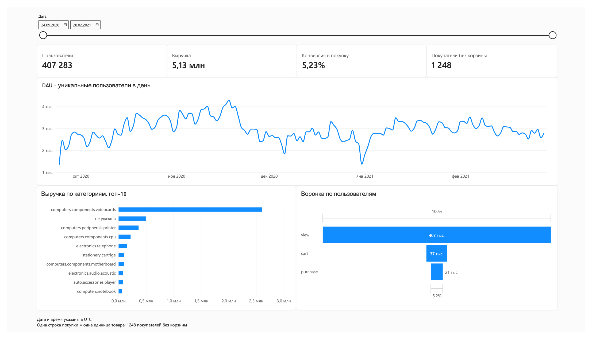
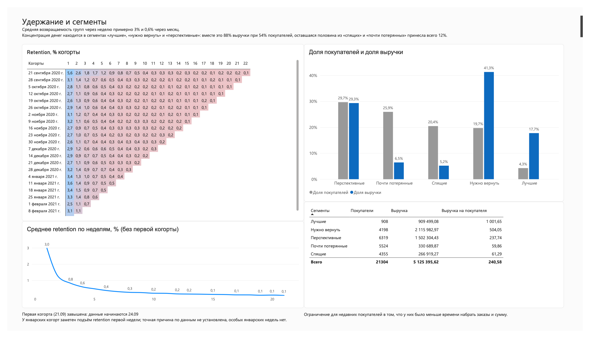

# Поведение покупателей магазина электроники REES46: версия 0.3

## Вопросы и главный результат

Версия 0.3 переходит от заказов Olist к поведенческим событиям интернет-магазина электроники: просмотрам, добавлениям в корзину и покупкам. Это данные, на которых строится продуктовая аналитика. Три вопроса:

1. **Где теряем покупателей внутри визита?** Воронка по сессиям.
2. **Возвращаются ли люди?** Недельные когорты и retention.
3. **Кто приносит деньги?** RFM-сегменты покупателей.

**Главный результат.** Покупкой заканчивается 4,77% визитов. Почти вся потеря происходит до корзины: корзина есть лишь в 8,1% визитов, а из визитов с корзиной до покупки доходят около 59%. Люди приходят под конкретную покупку и почти не возвращаются: через неделю на сайт заходит около 3% новичков, через месяц — около 0,6%. Деньги сосредоточены у небольшой части покупателей: «лучшие» — 4% покупателей и 18% выручки; вместе с сегментом «нужно вернуть» — четверть покупателей и почти 60% выручки.

Расчёты — SQL в PostgreSQL ([sql/rees46](../../sql/rees46/README.md)), визуализация — дашборд Power BI на двух страницах ([описание](dashboard.md)).

## Данные

Источник — [eCommerce events history in electronics store](https://www.kaggle.com/datasets/mkechinov/ecommerce-events-history-in-electronics-store) (REES46). Один файл `events.csv`, одна строка — одно событие пользователя с товаром.

| Показатель | Значение |
|---|---:|
| События | 885 129 |
| — просмотры (`view`) | 793 748 |
| — добавления в корзину (`cart`) | 54 035 |
| — покупки (`purchase`) | 37 346 |
| Пользователи | 407 283 |
| Выручка (сумма `price` покупок) | 5 125 395,62 |
| Период, UTC | 24.09.2020 11:57 — 28.02.2021 23:59 |

Пропуски: `category_code` — 236 219 событий (26,7%), `brand` — 212 364, `user_session` — 165. Загрузка в PostgreSQL сверена с CSV по 11 показателям ([SQL 02](../../sql/rees46/02_verify_import.sql)). Валюта цен в наборе не указана; суммы приводятся в единицах набора.

## Общая картина: дашборд, страница 1

- **Воронка по пользователям:** 407 283 → 36 952 с корзиной (9,1%) → 21 304 с покупкой. Конверсия пользователя в покупку — **5,23%**.
- **1 248 покупателей ни разу не добавляли товар в корзину.** Возможные причины: покупка в обход корзины, корзина до начала данных, потеря событий. Различить их по данным нельзя.
- **DAU** держится около 2,5–4 тыс. пользователей в день, пик — 18.11.2020 (4 287), провал — 31.12.2020 (1 370). Первая точка ниже из-за неполного дня: данные начинаются в 11:57.
- **Выручка по категориям:** видеокарты — около 51% выручки. Второе место (около 9,6%) — товары без категории; они показаны отдельно, а не исключены.

## 1. Воронка по сессиям

### Что считать визитом

У событий есть готовая разметка сессий сайта `user_session`. Перед расчётом проверено, похожа ли она на один заход:

| Показатель `user_session` | Значение |
|---|---:|
| Сессий | 490 398 |
| Из одного события | 71,3% |
| Медианная длительность, сессии из 2+ событий | 3,7 мин |
| Средняя длительность | 420 мин |
| Самая длинная сессия | ≈ 155 дней |
| Сессий с паузой больше 30 минут внутри | 27 466 (5,6%) |
| Сессий с несколькими `user_id` | 214 (0,04%) |

Сайт иногда продолжал один номер сессии неделями и склеивал несколько заходов. Такие сессии нельзя отбросить: среди них **18,5% заканчиваются покупкой** — почти вчетверо чаще среднего. Поэтому сессии разрезаны по стандартному правилу: **пауза больше 30 минут начинает новый визит**. Пауза до предыдущего события считается через `LAG`, номер визита — нарастающей суммой флагов «начало визита». 165 событий без `user_session` (просмотры и корзины, покупок нет) в сессионные метрики не входят.

### Результат

| Определение сессии | Сессий | С просмотром | С корзиной | С покупкой |
|---|---:|---:|---:|---:|
| `user_session` сайта | 490 398 | 99,58% | 8,42% | 4,96% |
| 30-минутные визиты | 539 734 | 99,42% | 8,08% | **4,77%** |

Разрезание добавило 49 336 визитов, а визитов с покупкой — только 1 401: новые куски в основном «вернулся посмотреть». Шаг «корзина → покупка»: 25 745 / 43 613 ≈ 59%. В среднем 1,33 визита на пользователя, поэтому сессионная конверсия (4,77%) близка к пользовательской (5,23%).

**Вывод.** Главная потеря — шаг «просмотр → корзина»: корзина появляется лишь в 8,1% визитов. Кто положил товар в корзину, чаще всего покупает.

## 2. Возвращаются ли люди: недельные когорты

- **Когорта** — календарная неделя (с понедельника) первого события пользователя в данных; 23 когорты с 21.09.2020. Каждый пользователь входит ровно в одну когорту.
- **Вернулся** — любое событие в одну из следующих недель.
- **Retention недели N** — доля когорты, активная через N недель после недели первого визита.

| Когорта | Размер | Неделя 1 | Неделя 4 |
|---|---:|---:|---:|
| 21.09.2020 | 7 691 | 5,6% | 1,7% |
| 28.09.2020 | 16 563 | 3,1% | 0,7% |
| 05.10.2020 | 15 982 | 2,8% | 0,6% |
| 12.10.2020 | 19 143 | 2,7% | 0,6% |
| 19.10.2020 | 21 095 | 2,6% | 0,6% |

Средний retention без первой когорты: неделя 1 — 3,0%, неделя 2 — 1,2%, неделя 4 — 0,6%, неделя 8 — 0,3%, к 20-й неделе — 0,1%.

**Первая когорта завышена.** Данные начинаются 24.09, а сайт работал и раньше. Постоянные покупатели, которых мы впервые видим в первую неделю, записаны в «новые», а возвращаются они чаще. Поэтому выводы делаются по остальным когортам.

**Январские когорты возвращаются чаще:** 3,3–3,6% в неделю 1 против 2,6–2,9% у октябрьских и ноябрьских. Разница не случайна: когорта 11.01 — 685 из 18 963 (3,6%), когорта 12.10 — 518 из 19 143 (2,7%); χ² p < 0,001, 95% доверительные интервалы 3,4–3,9% и 2,5–2,9% не пересекаются. Эффект небольшой по абсолютной величине (+0,9 п. п., V Крамера 0,026), но относительно заметный — в 1,33 раза. Старые когорты в январские календарные недели не растут (0,1–0,2%), то есть особых недель, которые тянули бы на сайт всех, не видно. Причина по данным не установлена.

**Вывод.** Через неделю возвращается около 3% новичков, через месяц — около 0,6%. Для магазина электроники это согласуется с покупкой под задачу: человек приходит за конкретным товаром и долго не возвращается.

## 3. Кто приносит деньги: RFM-сегменты

Сегментируются 21 304 покупателя.

| Показатель | Определение | Баллы 1 / 2 / 3 |
|---|---|---|
| **R** — давность | дней от последней покупки до 28.02.2021 | больше 101 / 46–101 / до 45 дней |
| **F** — частота | число заказов; покупки в одном 30-минутном визите — один заказ | 1 / 2 / 3 и больше |
| **M** — деньги | сумма покупок | до 44,66 / до 202,67 / больше |

У 84% покупателей один заказ, поэтому F нельзя разделить на равные трети — его баллы заданы по смыслу. R и M разделены по терцилям через границы `percentile_disc`. Функция `ntile(3)` здесь не подходит: на стыках групп она раздаёт разные баллы людям с одинаковой давностью или суммой.

Сегменты:

- **Лучшие** — недавние, повторные и крупные: 3-2-3, 3-3-3, 3-3-2 (R-F-M);
- **Перспективные** — остальные недавние;
- **Нужно вернуть** — давние, но ценные: крупная сумма (M = 3) либо несколько заказов на среднюю сумму;
- **Спящие** — остальные покупатели средней давности;
- **Почти потерянные** — остальные давние.

| Сегмент | Покупателей | Доля | Выручка | Доля выручки | Выручка на покупателя |
|---|---:|---:|---:|---:|---:|
| Лучшие | 908 | 4,3% | 909 499,08 | 17,7% | 1 001,65 |
| Перспективные | 6 319 | 29,7% | 1 502 304,43 | 29,3% | 237,74 |
| Нужно вернуть | 4 198 | 19,7% | 2 115 982,97 | 41,3% | 504,05 |
| Спящие | 4 355 | 20,4% | 266 919,27 | 5,2% | 61,29 |
| Почти потерянные | 5 524 | 25,9% | 330 689,87 | 6,5% | 59,86 |
| **Всего** | 21 304 | | 5 125 395,62 | | 240,58 |

**Вывод.** «Лучшие», «нужно вернуть» и «перспективные» дали 88% выручки при 54% покупателей; «спящие» и «почти потерянные» — почти половина покупателей и 12% выручки. Недавние покупатели («лучшие» и «перспективные») принесли 47% выручки при 34% покупателей. С ними стоит работать на удержание. Сегмент «нужно вернуть» — главный кандидат для возврата, но около 2 700 из 4 198 человек в нём сделали один крупный заказ: купивший видеокарту может просто не нуждаться в новой. Эффект предложений для этого сегмента нужно проверять экспериментом, а не предполагать.

## Ограничения

- **Края данных.** Слева — пользователи, приходившие до 24.09, записаны в первую когорту как новые. Справа — у покупателей и когорт последних недель было меньше времени вернуться, набрать заказы и сумму.
- **Порог 30 минут условен.** При другом пороге число визитов и сессионная конверсия немного сдвинутся.
- **Нет событий между просмотром и корзиной.** Причину главного отвала (цена, наличие, сравнение с другими магазинами) по этим данным установить нельзя.
- **Количества товара нет.** Одна строка покупки считается одной единицей; заказ восстановлен по визиту, номера заказа в данных нет.
- **Идентификация пользователя.** 214 сессий содержат несколько `user_id` (вероятно, вход в аккаунт посреди визита); один человек на разных устройствах может считаться несколькими пользователями.
- **Время в UTC.** Для Казахстана граница дня сдвинута на 5 часов; это влияет на дневные показатели (DAU).
- **Наблюдательные данные.** Сегменты описывают прошлое поведение; действия для них — гипотезы для экспериментов.

## Возможное продолжение

1. Проверить на A/B-тесте предложение для сегмента «нужно вернуть».
2. Разобрать отвал «просмотр → корзина» по категориям и ценам.
3. Посмотреть retention по покупкам (повторные покупки), а не по любым событиям.

[SQL](../../sql/rees46/README.md) · [Дашборд](dashboard.md) · [Порядок воспроизведения](../../docs/reproduce.md#7-повторить-анализ-rees46-версия-03)
