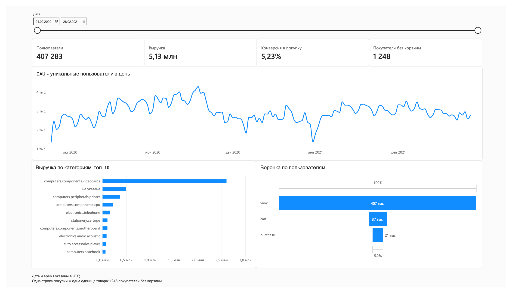
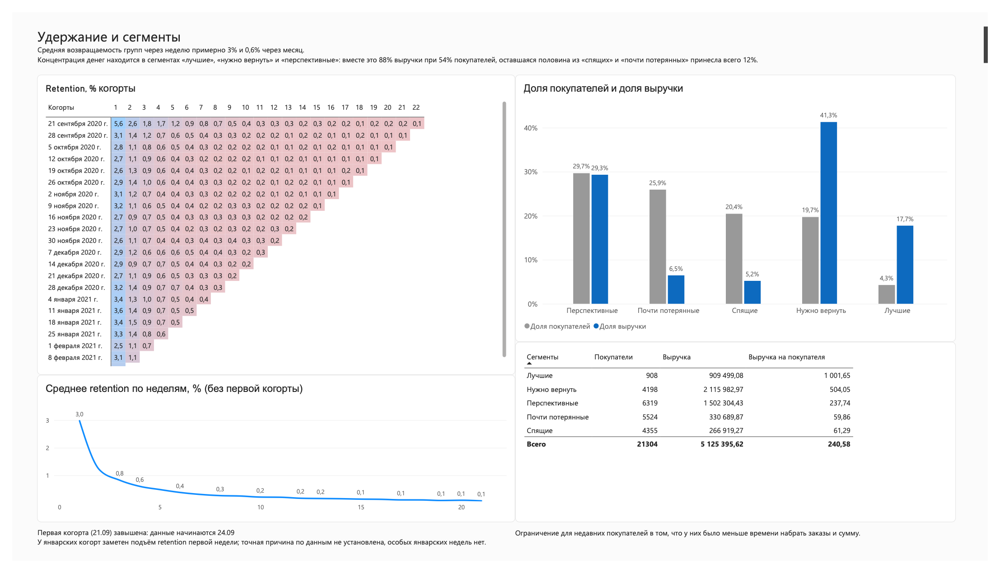

# REES46 — дашборд Power BI

Дашборд собран в Power BI Desktop на двух страницах. Файл `.pbix` в репозиторий не входит: он содержит загруженные исходные данные набора. Ниже — снимки, источники и меры, по которым дашборд собирается заново.

## Страница 1. Общая картина

Источник — исходный `events.csv`, загруженный файлом. При загрузке:

- `price` записан с точкой — тип «Десятичное число» через локаль «Английский (США)»;
- из `event_time` удалена приписка ` UTC`, затем тип «Дата/время» через ту же локаль;
- `product_id`, `category_id`, `user_id` — тип «Текст»: это идентификаторы, а длинные числа могут округлиться;
- пустой `category_code` заменён на «не указана»;
- вычисляемый столбец `Дата = DATE(YEAR(events[event_time]); MONTH(events[event_time]); DAY(events[event_time]))`.

| Мера | DAX |
|---|---|
| Выручка | `CALCULATE(SUM(events[price]); events[event_type] = "purchase")` |
| Пользователи | `DISTINCTCOUNT(events[user_id])` |
| Пользователи с корзиной | `CALCULATE([Пользователи]; events[event_type] = "cart")` |
| Пользователи с покупкой | `CALCULATE([Пользователи]; events[event_type] = "purchase")` |
| Конверсия в покупку | `DIVIDE([Пользователи с покупкой]; [Пользователи])` |
| Покупатели без корзины | `COUNTROWS(EXCEPT(CALCULATETABLE(VALUES(events[user_id]); events[event_type] = "purchase"); CALCULATETABLE(VALUES(events[user_id]); events[event_type] = "cart")))` |

Визуализации: карточки мер; DAU — `Пользователи` по `Дата`; выручка — `Выручка` по `category_code`, фильтр «10 первых»; воронка — `Пользователи` по `event_type`; срез по `Дата`.

## Страница 2. Удержание и сегменты

Источники — результаты SQL, выгруженные в CSV из DBeaver:

- [SQL 04](../../sql/rees46/04_retention_cohorts.sql) — `week_start, week_no, cnt, retention`, 276 строк;
- [SQL 05](../../sql/rees46/05_rfm_segments.sql) — таблица покупателей `e7` (запрос выгрузки указан в шапке файла), 21 304 строки.

`retention` и `monetary` записаны с точкой — загружать через локаль «Английский (США)». Коды сегментов заменены на русские названия.

| Элемент | Настройка |
|---|---|
| Матрица когорт | Строки `week_start`, столбцы `week_no`, значение `retention`; неделя 0 и итоги скрыты, цвет фона — градиент |
| Средний retention | Среднее `retention` по `week_no`; первая когорта (21.09.2020) исключена фильтром визуала |
| Доли сегментов | `Доля покупателей = DIVIDE([Покупатели]; CALCULATE([Покупатели]; ALL(rfm)))` и аналогичная доля выручки, где `Покупатели = COUNTROWS(rfm)`, `Выручка = SUM(rfm[monetary])` |
| Таблица сегментов | Покупатели, выручка, выручка на покупателя = выручка / покупатели |

На снимке матрица прокручивается: последняя когорта (15.02.2021, неделя 1 — 2,9%) скрыта за краем визуала; полная таблица — результат SQL 04.

[Отчёт](REPORT.md) · [SQL](../../sql/rees46/README.md)
