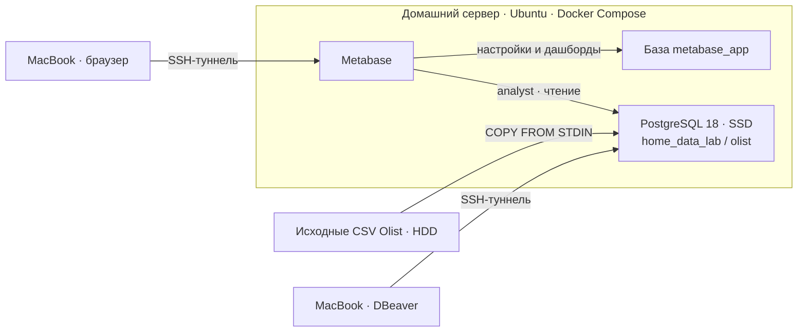

# Архитектура Home Data Lab

Лаборатория объединяет собственный сервер хранения и обработки данных, SQL-клиент на рабочем компьютере и BI-инструмент в браузере.

## Среда

| Часть | Конфигурация |
|---|---|
| Сервер | Ryzen 3 1200, 16 ГБ RAM, Ubuntu 24.04 LTS |
| Диски | SSD 512 ГБ: система, Docker и том PostgreSQL; HDD 1 ТБ: исходные файлы |
| PostgreSQL | Образ `postgres:18`, сервис Compose `database`, база `home_data_lab`, схема `olist` |
| Хранение PostgreSQL | Именованный том, каталог в контейнере `/var/lib/postgresql` |
| SQL-клиент | DBeaver на MacBook, подключение через SSH |
| BI | Metabase `v0.65.3.3`, отдельный Compose-проект, общая Docker-сеть с PostgreSQL |

## Разделение ролей и доступа

- `lab_admin` создаёт таблицы и загружает данные.
- `analyst` читает схему `olist`; эта роль используется для анализа и подключения Metabase.
- `metabase_app` владеет отдельной служебной базой Metabase. В ней хранятся пользователи BI, вопросы, настройки и расположение карточек.

PostgreSQL опубликован на `127.0.0.1:15432` сервера, Metabase — на `127.0.0.1:3000`. С рабочего компьютера доступ идёт через SSH-туннели. Внутри Docker-сети Metabase обращается к `database:5432` напрямую.

## Почему так устроено

**Docker Compose** описывает запуск сервисов, а именованный том отделяет данные PostgreSQL от жизненного цикла контейнера. **HDD** хранит исходные выгрузки; **SSD** используется для системы и базы. **DBeaver** позволяет работать с SQL с привычного рабочего компьютера. **Metabase** использует те же данные и правила расчёта для представления результатов.

Исходные таблицы сохраняют структуру CSV. Первичные и внешние ключи пока не заданы: импорт проверяется отдельно, а для анализа проверены необходимые идентификаторы и соединение заказов с отзывами. Полная проверка всех связей набора остаётся за рамками первой версии.

## Границы воспроизведения

Конфигурация Metabase включена в [репозиторий](../infra/metabase/README.md). Compose-файл PostgreSQL действующей среды не включён; его параметры описаны выше. Перед загрузкой необходимо подготовить базу, роли, том и Docker-сеть. Общая инструкция — [воспроизведение](reproduce.md).

Снимок дашборда, SQL и инструкция позволяют собрать визуализации вручную. Для восстановления самого экземпляра Metabase нужна резервная копия `metabase_app`; её дамп в репозиторий не входит.
